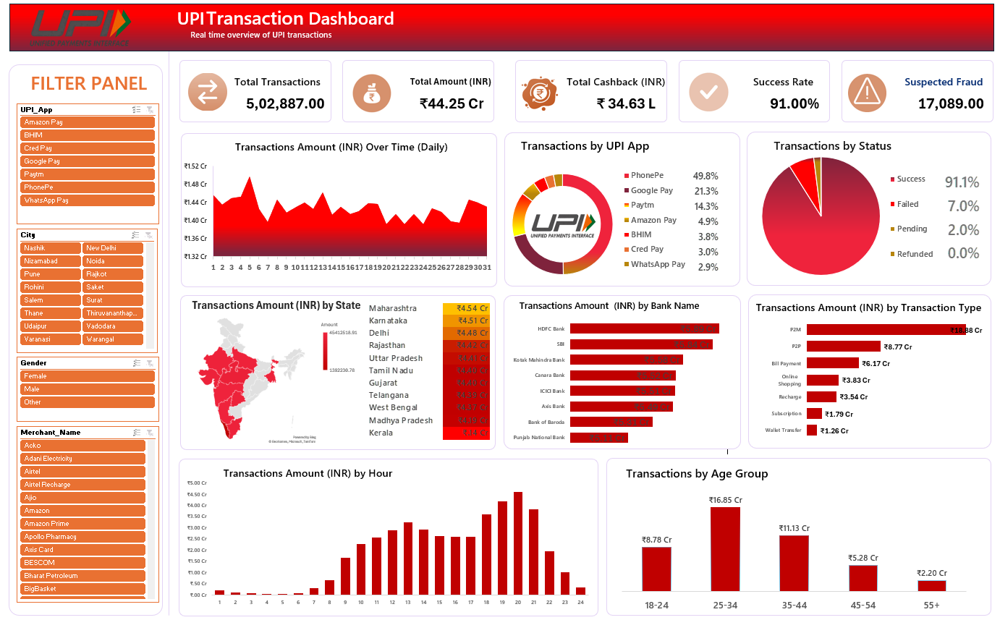

UPI Transaction Dashboard

An Excel-Based Data Analysis Project

Project Overview

This project focuses on analyzing UPI transaction data using Microsoft Excel. The dashboard presents key performance indicators (KPIs) and visual insights into transaction trends, payment methods, transaction status, and customer demographics.

Objectives

- Analyze UPI transaction performance and patterns.
- Compare transaction activity across UPI applications.
- Examine transaction status and success rates.
- Analyze transaction amounts by state, bank, and transaction type.
- Identify hourly and age-group transaction patterns.
- Present data through a structured visual dashboard.

Key Performance Indicators

- Total Transactions
- Total Transaction Amount (INR)
- Total Cashback (INR)
- Transaction Success Rate
- Suspected Fraud Transactions

Dashboard Features

- Daily transaction amount trends
- UPI application-wise comparison
- Transaction status distribution
- State-wise transaction analysis
- Bank-wise transaction amount comparison
- Transaction type analysis
- Hour-wise transaction patterns
- Age-group analysis

Interactive Filters

- UPI Application
- City
- Gender
- Merchant Name

Tools and Skills

- Microsoft Excel
- Data Analysis
- Data Visualization
- Dashboard Development
- Business Reporting

Dashboard Preview

"UPI Transaction Dashboard" (UPI-Dashboard-Preview.png.png)

Project Files

File| Description

Key Learning Outcomes

- Practiced analyzing transaction data using Excel.
- Developed data visualization and dashboard presentation skills.
- Explored transaction patterns across multiple categories.
- Practiced presenting analytical information in a structured format.

Author

Aditya Lone
Data Analyst
Skills: Microsoft Excel | SQL | Power BI
"GitHub Profile" (https://github.com/loneaditya14-png)
